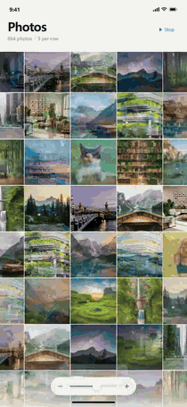

# Photo Grid Lab

**轻轻一捏，看见更多。**

一个受苹果相册启发、使用 HTML、Canvas 2D 和原生 JavaScript 手工实现的照片网格。重点探索连续缩放、焦点照片保持，以及从大图到密集照片墙的过渡手感。

[English README](README.md) · [在线展示网站](https://one-num-three.github.io/photo-grid-lab/?lang=zh) · [直接试玩](https://one-num-three.github.io/photo-grid-lab/demo/index.html?lang=zh) · [下载演示视频](https://github.com/one-num-three/photo-grid-lab/releases/download/v0.1.0/photo-grid-demo.mp4)

[](https://github.com/one-num-three/photo-grid-lab/stargazers) [](LICENSE)

<p align="center"><a href="https://one-num-three.github.io/photo-grid-lab/?lang=zh"></a></p>

## 可以体验什么

- **连续缩放：** 在每行 1、3、5、9、13 张之间跟随手势变化，松手后吸附到最近的稳定档位。
- **看住同一张照片：** 以手指指向的照片为中心，补偿网格位置；靠近内容首尾时受到滚动边界限制。
- **紧密的照片墙：** 两层完整网格围绕同一焦点缩放、交叉过渡，焦点照片保持不透明。
- **自然停下的滚动：** 拖动、松手、惯性衰减；到边缘时增加阻力并回弹。
- **可分享的展示：** 中英文网站、独立试玩、实际浏览器录屏，以及此前相册相机的界面概念稿。
- **没有运行时依赖：** 不需要框架、后端、账号或数据分析服务。独立演示已内嵌照片，可以离线打开。

网格中是由 **28 张素材生成的 864 条模拟记录**。重复照片和模拟日期用于演示布局，没有读取任何人的真实相册。

## 操作方式

| 输入 | 效果 |
| --- | --- |
| 双指捏合 | 连续放大、缩小 |
| 单指拖动 | 浏览照片，松手后继续惯性滚动 |
| Ctrl 或 Command 加滚轮 | 围绕鼠标位置缩放 |
| 普通滚轮、鼠标拖动 | 上下浏览 |
| 底部加减按钮、滑块 | 调整照片大小 |
| Alt 加鼠标纵向拖动 | 模拟连续缩放 |
| 双击 | 放大一档；单列时回到 3 列 |
| 加减键 | 切换密度 |
| 方向键、Page Up、Page Down | 浏览；滑块获得焦点时方向键控制缩放 |
| Home、End | 到滚动首尾；滑块获得焦点时到大小端点 |
| 演示按钮 | 自动展示或停止完整密度变化 |

网站提供语言切换，也可以在网页或独立演示地址后添加 `?lang=zh` 或 `?lang=en`。已写入 Safari gesture 事件兼容处理；真实 macOS 触控板仍需设备验证。

## 本地运行

仅试玩网格时，可以直接双击：

```text
demo/index.html
```

完整展示网站及内嵌交互需要通过 HTTP 打开，在仓库目录执行：

```sh
python -m http.server 8000
```

然后访问 `http://localhost:8000`。不需要安装 npm 依赖，也不需要构建网站。

## 文件结构

```text
index.html                  中英文展示网站
style.css / app.js          布局、语言切换和图片预览
demo/index.html             可直接运行的单文件网格
demo/source.html            修改网格的开发模板
demo/photos/                演示照片缓存
demo/photo-sources.json     照片来源
tools/build-demo.py         离线构建脚本
assets/                     预览 GIF、视频封面、设计稿与分享封面
media/photo-grid-demo.mp4   用于下载的竖屏录屏
media/photo-grid-demo-web.mp4  网页播放用的精简视频
docs/                       实现说明、检查记录和分享文案
```

修改网格时，编辑 `demo/source.html`，再生成成品：

```sh
python tools/build-demo.py
```

脚本只使用 Python 标准库和仓库中的素材缓存。只修改 `demo/index.html` 会在下次构建时被覆盖。

## 实现思路

1. 在手势中心找到焦点照片，记录照片序号和手指在照片内的相对位置。
2. 计算相邻两档布局，连续插值焦点照片的尺寸和位置。
3. 两层完整照片网格围绕同一焦点缩放并交叉过渡，焦点照片单独保持清楚。
4. 补偿滚动量与横向偏移，再柔和地吸附到稳定密度。

Canvas 绘制视口及附近区域，不创建几百个照片 DOM 元素。[实现说明](docs/implementation.zh-CN.md)记录了主要参数、动画打断处理和当前边界。

## 完成状态

当前是 **网页交互原型**，不是可安装的 iOS App，也不承诺与苹果相册逐像素一致。网站中的相册相机页面是此前的视觉概念稿，尚未实现为可操作页面。

已在桌面 Chromium 和模拟多点触摸环境检查主要操作、五档缩放、中途打断、响应式布局和减少动态效果。真实 iPhone Safari、macOS 触控板及大规模独立照片库还需验证；Canvas 内每张照片尚未独立提供屏幕阅读器访问。详情见[检查记录](docs/QA.md)。

演示视频录制自实际运行的浏览器原型，没有配乐。仓库提供竖屏 MP4 和预览 GIF，方便分享和上传视频网站。

## 参与改进

欢迎提交 Issue 或 Pull Request，尤其是手势边界、浏览器兼容、键盘与屏幕阅读器体验，以及同一交互的原生实现。反馈手势问题时，请附上浏览器、设备和操作顺序。

如果这个效果给了你一点灵感，欢迎点一颗 Star，让更多人发现它。分享短视频时，可以同时附上在线试玩和仓库链接。

## 素材与协议

项目原创代码采用 [MIT 协议](LICENSE)。示例照片及它们在截图、录屏中的使用遵循 [Unsplash License](https://unsplash.com/license)，来源记录在[素材清单](demo/photo-sources.json)中；另见[第三方素材说明](THIRD_PARTY_NOTICES.md)。

这是受 Apple Photos 启发的独立交互研究，与 Apple 无关联，不是 Apple 的产品或官方项目。
